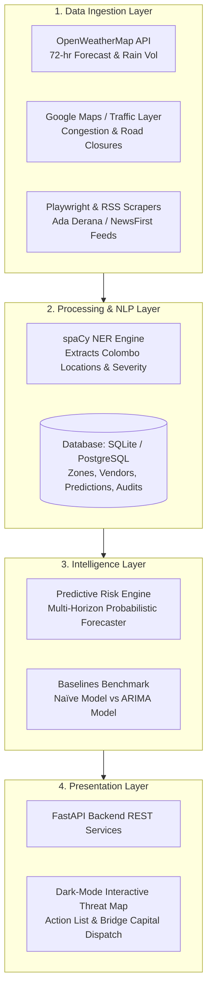

# VendorPulse (ModelX 2.0)
> **Predictive Early-Warning Intelligence Platform for Hyper-Local Informal Vendor Liquidity Shielding**

[](https://github.com/Sahas-sass/VendorPulse)
[](LICENSE)
[](https://python.org)
[](https://fastapi.tiangolo.com)
[](https://react.dev)

---

## 📌 Overview

**VendorPulse** is an automated, multi-modal early-warning system designed specifically for **Micro-Finance NGO Field Outreach Coordinators** operating in high-density urban commercial zones (focused on Colombo 01–15, Sri Lanka, e.g., Pettah, Maradana, Fort).

In informal street markets, vendors operate strictly on daily cash-flow: **today’s profits fund tomorrow’s inventory**. When acute, localized disruptions strike—such as sudden flash flooding, unannounced municipal road closures, or spontaneous bus transit strikes—pedestrian foot traffic collapses. Lacking institutional buffers, informal hawkers are forced to borrow from predatory local money-lenders charging ruinous interest rates (10% to 20% weekly), destroying months of economic progress in a single weekend.

### The Paradigm Shift
Traditional micro-finance institutions and relief agencies act **retroactively**—providing assistance only after vendors default or enter debt traps. **VendorPulse shifts coordinators from reactive recovery to proactive shielding**, delivering high-confidence 48-to-72-hour cash-flow collapse predictions that allow rapid zero-interest bridge micro-loans to be authorized and dispatched *before* the disruption hits.

---

## 🏛️ System Architecture



---

## 🚀 Key Features

* **Hyper-Local Multi-Modal Ingestion**: Correlates micro-climate precipitation forecasts, urban transit disruptions, and municipal road closures.
* **spaCy-Powered Disruption Extraction**: Automatic Named Entity Recognition mapping unstructured news releases to specific Colombo commercial blocks (e.g., "Pettah Market", "Galle Road", "Maradana").
* **Probabilistic Cash-Flow Collapse Forecasting**: Quantile loss ($P_{50}, P_{90}$) confidence intervals predicting foot-traffic cliff-edges with low false-positive rates (< 20%).
* **Benchmarked Against Strict Baselines**: Validated against both a Naïve Baseline and a Classical ARIMA model.
* **NGO Coordinator Threat Map UI**: Dark-mode, high-stress field interface with color-coded heat zones (Yellow, Orange, Red) and real-time risk drivers.
* **1-Click Emergency Bridge Authorization**: Direct field dispatch workflow with audit logging and simulated officer notifications.

---

## 📂 Repository Structure

```text
VendorPulse-ModelX/
├── backend/                  # FastAPI backend server
│   ├── app/
│   │   ├── api/              # REST endpoints (/zones, /predictions, /dispatch)
│   │   ├── core/             # Configuration & DB initialization
│   │   ├── models/           # DB tables & Pydantic schemas
│   │   └── services/         # Dispatch orchestration & risk calculation
│   ├── requirements.txt      # Python backend dependencies
│   └── main.py               # Application entrypoint
│
├── ml_engine/                # Machine learning forecasters & evaluation
│   ├── models/               # Multi-horizon risk forecaster
│   ├── baselines/            # Naïve and ARIMA baseline models
│   ├── evaluation/           # Evaluation metrics (Quantile Loss, F1, FPR)
│   └── data/                 # Colombo historical calibration datasets
│
├── data_pipeline/            # Scrapers, API clients, and NLP
│   ├── weather/              # OpenWeatherMap client & cached data
│   ├── traffic/              # Traffic anomaly & transit route monitor
│   ├── nlp/                  # spaCy geographic entity extractor
│   └── scheduler.py          # 3-hour automated background worker
│
├── frontend/                 # Interactive Field Dashboard (React + Tailwind)
│   ├── src/
│   │   ├── components/       # ThreatMap, ActionList, ZoneDetailCard, Modal
│   │   ├── api/              # Axios/Fetch client integration
│   │   └── App.jsx           # Main coordinator application
│   └── package.json          # Frontend dependencies & scripts
│
├── docs/                     # Deliverables for ModelX 2.0
│   ├── technical_report.md   # Complete technical architecture & evaluation
│   ├── two_page_summary.md   # Executive 2-page brief
│   └── video_demo_script.md  # 3-minute presentation script
│
├── .env.example              # Sample environment configurations
├── .gitignore                # Production gitignore
└── README.md                 # Primary documentation
```

---

## 🛠️ Quickstart Guide

### 1. Prerequisites
- Python 3.10+
- Node.js 18+ & npm
- Git

### 2. Backend Setup
```bash
# Clone the repository
git clone https://github.com/Sahas-sass/VendorPulse.git
cd VendorPulse

# Navigate to backend
cd backend

# Create virtual environment
python -m venv venv
# On Windows:
.\venv\Scripts\activate
# On Linux/macOS:
source venv/bin/activate

# Install dependencies
pip install -r requirements.txt

# Start backend server
uvicorn main:app --reload --port 8000
```
Backend will be live at `http://localhost:8000` (API docs at `http://localhost:8000/docs`).

### 3. Frontend Setup
```bash
# In a new terminal, navigate to frontend
cd frontend

# Install dependencies
npm install

# Start Vite development server
npm run dev
```
Frontend will be available at `http://localhost:5173`.

---

## 👥 Team Details

* **Author:** Sahas Abeygunarathne ([sahas.samuditha@gmail.com](mailto:sahas.samuditha@gmail.com))
* **Institution:** University of Moratuwa
* **Team:** Nexio
* **Host Organization:** IEEE Computational Intelligence Society Student Chapter, IIT
